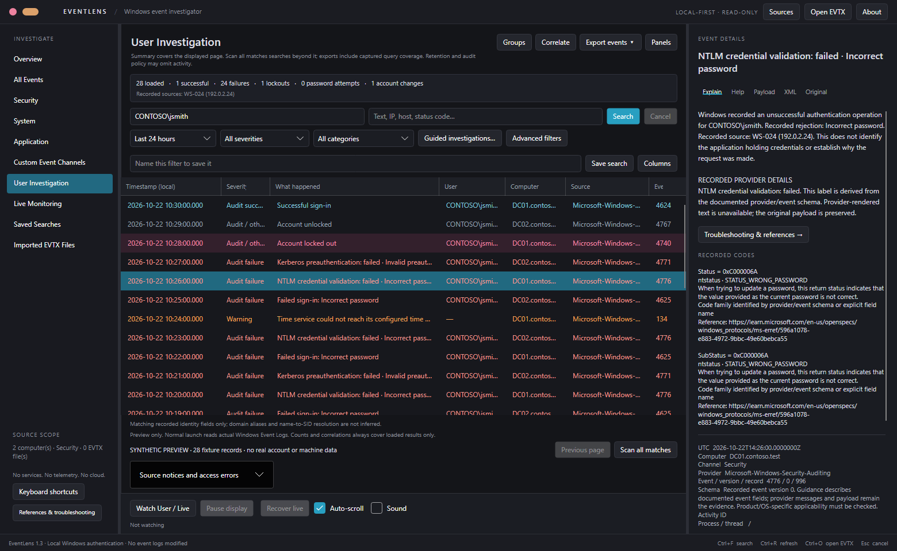
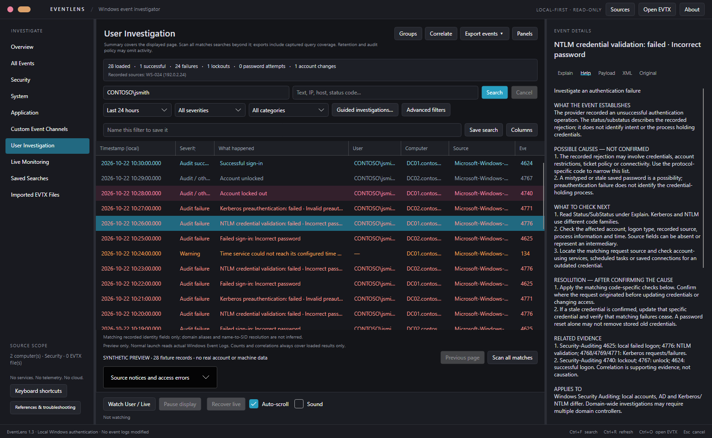

# EventLens

A portable, read-only Windows Event Log investigator for IT administrators.
Native C# / .NET 10 LTS / Avalonia desktop UI. No accounts, cloud, telemetry,
installed services, scheduled tasks or remote agents.

## Start here

- [User guide](docs/user-guide.md): setup, first investigation, exports, live monitoring, and troubleshooting.
- [Investigation workflows](docs/investigation-guide.md): full-history searches and evidence handling.
- [Permissions and privacy](docs/permissions-and-privacy.md) and [security policy](SECURITY.md).
- [Build from source](docs/build.md), [contributing](CONTRIBUTING.md), and [MIT license](LICENSE).

Screenshots use synthetic demonstration events, not private logs. Download a portable
package only when one is attached to a published repository release; otherwise build
from source. EventLens complements [HardwareLens](https://github.com/MadMoriarty/HardwareLens),
a separate hardware/performance and app-management utility. Both run independently.

## Run

Extract `EventLens-win-x64.zip` and run `EventLens.exe`. Windows 10/11 or Windows
Server x64 with a supported .NET 10 OS baseline is required. No runtime needs to
be installed. The executable is self-contained and unsigned: Windows SmartScreen
may warn about unsigned or low-reputation downloads. This is not a claim of
Microsoft endorsement or a signed release.

The single executable extracts native runtime/graphics libraries to the normal
.NET per-user temporary extraction location on first launch. Settings use
`eventlens.settings.json` beside the executable when writable, otherwise
`%LOCALAPPDATA%/EventLens/`. Historical queries use a private temporary SQLite cache under the current user's
temporary directory (EventLens-QueryCache). It contains original event data, is
removed when its query is disposed, and may remain after a crash or forced exit.
Reports are kept only when you explicitly export them. Saved searches may contain account names you choose to save.
Delete the portable folder and settings to remove the app; no service is installed.

## Investigate

- Choose All Events or a channel. Default time range is 24 hours. **Sources**
  selects one or more computers and exact channel names; channel discovery uses
  the first selected computer. All Events combines Security/System/Application
  and imported files. Imported EVTX Files queries files only; originals stay read-only.
- Enter an exact username, `DOMAIN\user`, UPN or SID. Names match recorded fields
  case-insensitively. Subject/Target/Member roles distinguish actors from affected
  accounts. A bare name across domains is flagged; domain aliases and missing SIDs
  are not guessed. Some NTLM events omit domain/SID and cannot prove a qualified
  match. Use a bare name to examine ambiguous candidates, then inspect evidence.
- Search text covers messages and XML, including IPs, hostnames and status codes.
  Advanced filters include IDs, exact provider, recorded computer, source/IP,
  protocol, category and failure reason. Time/ID/provider/severity are native
  filters; name/text searches scan payloads/messages, not an instant index.
- Historical queries capture an upper time bound when Search starts. The displayed
  page normally contains up to 500 matches; Previous page / Next page browse a
  temporary disk-backed cache. Large individual records can reduce page size.
  **Scan all matches** exhausts accessible selected history, retaining matches on
  disk beyond the former 20,000-row limit. Progress and Cancel remain available;
  cancellation retains completed batches for continuing or exporting later.
  There is no fixed historical match-count cap; disk space and native log access
  remain practical limits. The cache is not a permanent full-text index.
- Time/ID/provider/severity predicates use Windows queries. Identity/text filters
  scan payloads/messages in bounded batches; a sparse first page is not the end
  while more history remains. Source failures are explicit. A captured time bound
  is not a transactionally frozen Windows log: rotation/retention and clock skew
  can still affect available evidence. Native RPC cleanup may outlast a UI wait.
- Details provide deterministic explanations, original provider text, all payload
  fields and original XML. Provider IDs are checked before interpreting numeric
  event IDs. Unknown events retain the provider message or state that it is missing.
- **Guided investigations > Account lockout** selects relevant authentication/lockout/unlock events.
  **Correlate** shows preceding failures and subsequent unlock/success within
  documented windows. Repeated failures are grouped by identity/source/reason.
  These are evidence associations, not proof of a root cause. Other domain
  controllers and the workstation may hold additional records; clocks may differ.
- **Export events** offers the displayed page as CSV/JSON, **ALL matching events**
  as JSON or a CSV ZIP bundle (events.csv + investigation.json), and one source as
  native EVTX. Full reports finish the captured query, deduplicate identical XML
  records and include the query, selected sources, counts, completeness and source
  errors. CSV bundles keep this metadata beside the data in one atomic file.
  Cancellation preserves an existing destination. **Ctrl+E** exports the displayed
  page. The Explain pane also exports a selected event.
- Native EVTX export uses time/provider/ID/severity filters only: identity, text,
  origin and category filters are NOT applied. The dialog states this explicitly;
  use all-match JSON/CSV for exact application filtering. EVTX originals remain
  unchanged. Provider message resources are not bundled with native exports.
- **Groups** expands repeated records without losing the individual evidence.
  Export the displayed page or a selected event as JSON/CSV. JSON preserves original
  XML; CSV neutralizes formula-leading cells. Review reports before sharing them.
- **Guided investigations** offers account lockout, failed sign-in, application
  crash, service failure and unexpected restart workflows. It sets provider-scoped
  event/channel selections, retains chosen computers and time range, and shows
  expected evidence, missing information and next checks. **Analyze all matches**
  scans the full captured query and produces a bounded evidence/count summary;
  **Copy summary** copies it for your notes. Findings do not establish a root cause.
  Clear the guided selection in the same dialog to return to ordinary filters.
- Save named searches locally, including time-range mode and selected computers/
  channels. Relative ranges are recalculated when run; custom UTC bounds remain
  fixed. Imported file paths are not saved in reusable filters.

## Explanations and code coverage

The offline reference contains 7,496 published Microsoft code definitions
(NTSTATUS, Win32, HRESULT and Kerberos) and 342 Security audit event labels.
**References & troubleshooting** shows source URLs, counts and fingerprints.
**Recorded codes** in Explain shows raw values, code families, exact symbols
and Microsoft descriptions. Ambiguous code families are marked as candidates.
This does not cover every Microsoft provider/code, and a catalog label is not
a detailed investigation rule or proof of root cause. Details retain event version,
activity ID and process/thread identifiers. Unreviewed versions of the supported
versioned authentication schemas withhold payload-sensitive interpretation rather
than silently assuming an older schema. See [coverage](docs/code-reference.md).

The application accent is teal-blue. Severity colors apply to every event cell:
orange warnings, red errors/audit failures, pink critical/lockouts, blue audit
successes, muted blue information and gray other/verbose records. Selected
rows retain their severity colors.

## Troubleshooting and additional references

Select an event and open **Help**, or click **Troubleshooting & references** in
Explain. The tool separates recorded facts, possible causes, next checks and
conditional resolution steps. Reviewed guidance is available offline for common
Windows authentication, lockout, service, crash, shutdown and task issues.

All three sources are integrated: Microsoft troubleshooting, Ultimate Windows
Security (389 indexed audit-event links), and EventSentry (382 indexed audit-event
links plus code lookup). Event links are matched to the provider. The lower-left
**References & troubleshooting** button opens the source directory and coverage.

External articles open in your browser when clicked; full third-party databases
are not embedded. No log contents or identity information are included in URLs.
JSON/CSV reports and the copy button retain the guidance and source references.
See [integration details](docs/troubleshooting-sources.md).

## Live monitoring

**Watch User / Live** subscribes to selected channels with captured filters.
The first start listens for new events. Transient source failures retry with
bounded backoff. An accepted per-source bookmark resumes retained later events;
bookmarks advance only after a matching event was queued (or an irrelevant event
was deliberately filtered). Replay duplicates are suppressed within a bounded
recent-event window. Same-filter stop/start can reuse checkpoints during this app
session; checkpoints are not saved across app restarts.

A stale/missing checkpoint triggers a clearly warned replay of retained history
with a two-minute timestamp overlap. This cannot recover cleared/overwritten logs
or guarantee coverage under clock skew. Source/gap notices remain visible.

Pause continues collection within a 4,096-match / 64 MB estimated-payload queue.
Overflow stops collection and reports unretained records without advancing the
rejected event's checkpoint. **Recover live** resumes display and requests replay
from accepted checkpoints. The live display retains at most 20,000 rows / 128 MB
estimated payload and reports eviction; it is not a permanent recorder.

Historical scans/exports use their captured search time bound. Run Search again
when you want a fresh historical query including the more recent live interval.
Changing live filters requires stop/start. Closing disposes subscriptions and
leaves no monitoring service. Real sustained remote delivery still needs lab
validation; there is no zero-loss guarantee.

## Permissions and remote sources

Launch does not require elevation. Security and some operational channels need
additional rights; EventLens reports access denial without bypassing Windows.
Remote reads/subscriptions use current Windows authentication over supported Event
Log RPC. You may need Event Log Readers membership, suitable Security-log rights,
Remote Event Log Management firewall rules, working RPC and domain connectivity.
The app does not modify those settings or collect passwords. It does not query AD
directory objects or discover domain controllers automatically; add their names.

## Development and verification

See [architecture review](docs/architecture-review.md),
[feature map](docs/features.md), and [validation](docs/validation.md).
Source/build instructions are in [docs/build.md](docs/build.md).

`tools/build.ps1` runs tests and publishes the self-contained portable x64 release.
`tools/bootstrap.ps1` can download Microsoft's SDK into the local `.tools` folder
and verifies SHA512 against release metadata; it does not install the SDK globally.

`EventLens.exe --diagnose <private-output-folder>` runs read-only native checks,
exports a small System EVTX subset and reimports it, tests CSV/JSON and briefly
attaches subscriptions. **Diagnostic outputs contain real local event data**;
keep them private. The application's default launch does not run this diagnostic.

No files are published to GitHub automatically. GitHub Actions workflows are
provided for builds/tests and manually triggered draft release packaging.

A step-by-step workflow guide is in [docs/investigation-guide.md](docs/investigation-guide.md).
